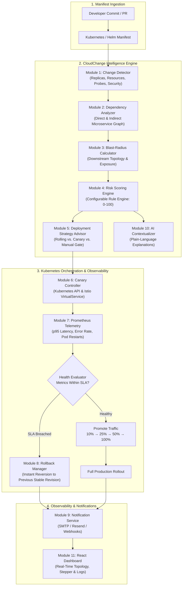

<div align="center">

# ☁️ CloudChange

### **Kubernetes Continuous Deployment Risk Engine & Progressive Rollout Controller**

[](https://gitlab.com/rgiridhar1008/cloudchange)
[](https://github.com/rgiridhar1008/CloudChange)
[-success?logo=pytest)](https://github.com/rgiridhar1008/CloudChange)
[](https://github.com/rgiridhar1008/CloudChange)
[](https://www.python.org/)
[](https://fastapi.tiangolo.com/)
[-61DAFB?logo=react)](https://react.dev/)
[](https://kubernetes.io/)
[](https://helm.sh/)
[](LICENSE)

<p align="center">
  <b>Intercept dangerous Kubernetes configuration changes before they cause downtime.</b><br>
  Deterministic Risk Engine • Dependency Blast-Radius Graph • Progressive Canary Rollouts • Prometheus Telemetry Gating • Automated Instant Rollback
</p>

[Explore Documentation](docs/) • [Architecture](docs/architecture.md) • [API Reference](docs/api.md) • [Live Dashboard](http://localhost:5173)

---

</div>

## 📌 Table of Contents
- [Executive Overview](#-executive-overview)
- [System Architecture](#-system-architecture)
- [Key Features](#-key-features)
- [Module Breakdown](#-module-breakdown)
- [Technology Stack](#-technology-stack)
- [Local Development Setup](#-local-development-setup)
- [Verification & Test Suite](#-verification--test-suite)
- [CI/CD Pipelines (GitHub & GitLab)](#-cicd-pipelines-github--gitlab)
- [API Reference](#-api-reference)
- [Repository Structure](#-repository-structure)
- [Contributing & License](#-contributing--license)

---

## 🚀 Executive Overview

Microservice rollouts frequently fail due to subtle, unreviewed manifest modifications—such as dropping readiness probes, over-reducing memory limits, or scaling down critical replicas during peak traffic.

**CloudChange** acts as an intelligent pre-flight gatekeeper and active runtime operator for Kubernetes deployments:
1. **Pre-Flight Interception:** Parses proposed Kubernetes YAML manifests against live cluster configurations to detect breaking regressions.
2. **Blast-Radius Mapping:** Computes upstream/downstream impact graphs across services, deployments, and pods.
3. **Deterministic Risk Scoring:** Evaluates changes against a configurable, database-backed rule engine (scoring 0–100) mapped to four operational risk tiers (`LOW`, `MEDIUM`, `HIGH`, `CRITICAL`).
4. **Strategy Formulation:** Automatically advises the safest rollout method (`RollingUpdate`, `Canary`, or `Manual Approval Gated`).
5. **Runtime Telemetry & Self-Healing:** Drives canary traffic increments (10% → 25% → 50% → 100%), continuously queries Prometheus telemetry, and initiates an immediate, automatic rollback if error rates or latency thresholds spike.

---

## 🏗️ System Architecture



---

## ✨ Key Features

* **Deterministic Risk Engine:** Transparent scoring model based on documented Kubernetes failure modes rather than opaque heuristics.
* **Microservice Blast Radius Calculation:** Computes multi-hop topological distance to determine how changes propagate through external gateways.
* **Progressive Traffic Steering:** Native Canary traffic shifting using Istio VirtualService weights or replica ratios (10% → 25% → 50% → 100%).
* **Live Prometheus Telemetry Gating:** Automatically tracks error rates (`> 2%`), p95 response latencies (`> 500ms`), and container restarts during rollouts.
* **Zero-Downtime Safe Rollback:** Automatically aborts failed rollouts and reverts deployments to verified historical revisions.
* **Non-Decision-Making AI Explanation:** Generates human-readable change rationales and suggested remediations without delegating decision authority.
* **Security & Supply Chain Hardening:** Docker images built non-root with Alpine/Debian patches; verified against Trivy for **0 HIGH and 0 CRITICAL CVEs**.

---

## 🧩 Module Breakdown

| Module | Core File | Functionality |
| :--- | :--- | :--- |
| **1. Configuration Change Detection** | [`change_detection/service.py`](backend/app/modules/change_detection/service.py) | Structural diffing of YAML manifests across replica scaling, resource requests/limits, probes, and security contexts. |
| **2. Dependency Analyzer** | [`dependency_analysis/analyzer.py`](backend/app/modules/dependency_analysis/analyzer.py) | Builds directed graphs of Kubernetes services, pods, and configs; includes baseline fallback for offline execution. |
| **3. Impact & Blast Radius** | [`impact_analysis/analyzer.py`](backend/app/modules/impact_analysis/analyzer.py) | Computes dependency depth, affected service count, and internet-facing ingress exposure. |
| **4. Risk Engine** | [`risk_analysis/engine.py`](backend/app/modules/risk_analysis/engine.py) | Evaluates rules, calculates total scores (0–100), maps risk levels, and self-heals default database rules. |
| **5. Strategy Advisor** | [`deployment_strategy/advisor.py`](backend/app/modules/deployment_strategy/advisor.py) | Recommends `ROLLING`, `CANARY`, or manual gating based on risk score and infrastructure capability. |
| **6. K8s Canary Controller** | [`canary_deployment/controller.py`](backend/app/modules/canary_deployment/controller.py) | Direct Kubernetes API integration driving progressive traffic splits and deployment scaling. |
| **7. Monitoring Service** | [`monitoring/service.py`](backend/app/modules/monitoring/service.py) | Live Prometheus query client measuring error rate, latency, restarts, and readiness state. |
| **8. Rollback Manager** | [`canary_deployment/rollback.py`](backend/app/modules/canary_deployment/rollback.py) | Restores deployment to verified revision upon health degradation; persists event history. |
| **9. Notification Service** | [`notifications/service.py`](backend/app/modules/notifications/service.py) | Dispatches deployment events, alerts, and rollbacks via SMTP/email with duplicate suppression. |
| **10. AI Contextualizer** | [`ai_explanation/engine.py`](backend/app/modules/ai_explanation/engine.py) | Translates numerical risk metrics into actionable human-readable explanations via OpenAI or rule templates. |
| **11. Web Dashboard** | [`frontend/src/`](frontend/src/) | React 18 SPA featuring interactive dependency graph, live Canary stepper, and Prometheus graphs. |
| **12. CI/CD & Automation** | [`.gitlab-ci.yml`](.gitlab-ci.yml), [`.github/workflows/`](.github/workflows/) | Multi-stage pipeline automating unit tests, image builds, Trivy scans, Helm linting, and child pipeline deployment. |

---

## 🛠️ Technology Stack

* **Backend:** Python 3.11+, [FastAPI](https://fastapi.tiangolo.com/), [SQLAlchemy 2.0](https://www.sqlalchemy.org/), [Pydantic v2](https://docs.pydantic.dev/), [Uvicorn](https://www.uvicorn.org/)
* **Frontend:** [React 18](https://react.dev/), [Vite](https://vitejs.dev/), [Axios](https://axios-http.com/), CSS Modules / Tailwind
* **Database:** PostgreSQL (production / local Docker) with transparent SQLite fallback
* **Containerization:** Multi-stage, non-root [Docker](https://www.docker.com/) images
* **Orchestration:** [Kubernetes](https://kubernetes.io/) (v1.28+), [Minikube](https://minikube.sigs.k8s.io/), [Helm 3](https://helm.sh/)
* **Observability:** [Prometheus](https://prometheus.io/)
* **Security:** [Aqua Security Trivy](https://github.com/aquasecurity/trivy) (Vulnerability & Misconfiguration Scanning)
* **CI/CD:** [GitLab CI/CD](https://docs.gitlab.com/ee/ci/) (with dynamic Child Pipelines) & [GitHub Actions](https://github.com/features/actions)

---

## 💻 Local Development Setup

### Prerequisites
* **Git** (`git --version`)
* **Python 3.11+** (`python --version`)
* **Node.js 18+** & **npm** (`node -v`, `npm -v`)
* **Docker Desktop** (`docker version`)
* *(Optional)* **Minikube** & **kubectl** (`minikube status`, `kubectl version`)

### 1. Clone the Repository
```bash
git clone https://github.com/rgiridhar1008/CloudChange.git
cd CloudChange
```

### 2. Start PostgreSQL Database
```bash
docker compose up -d db
```
*(If Docker is omitted, the application transparently defaults to local SQLite `cloudchange.db`).*

### 3. Run Backend API
```bash
cd backend
python -m venv venv
# On Windows PowerShell:
.\venv\Scripts\Activate.ps1
# On macOS/Linux:
# source venv/bin/activate

pip install -r requirements.txt
uvicorn app.main:app --host 0.0.0.0 --port 8000 --reload
```
* **API Health Check:** [http://localhost:8000/health](http://localhost:8000/health)
* **Interactive Swagger UI:** [http://localhost:8000/docs](http://localhost:8000/docs)

### 4. Run Frontend Dashboard
```bash
cd ../frontend
npm install
npm run dev
```
* **Web Dashboard:** [http://localhost:5173](http://localhost:5173)

### 5. (Optional) Run Local Kubernetes Cluster
```bash
minikube start --driver=docker
kubectl apply -f k8s/test-microservices.yaml
```

---

## 🧪 Verification & Test Suite

The project includes an end-to-end automated testing and security audit suite:

### Backend Unit & Integration Tests (100% Pass Rate)
```bash
cd backend
python -m pytest tests/ -v
```
```
============================= test session starts =============================
collected 54 items

tests/test_ai_explanation.py ......................... [  5%]
tests/test_api.py .................................... [ 12%]
tests/test_canary_deployment.py ...................... [ 18%]
tests/test_change_detector.py ........................ [ 33%]
tests/test_dependency_analysis.py .................... [ 38%]
tests/test_deployment_strategy.py .................... [ 46%]
tests/test_integration.py ............................ [ 50%]
tests/test_main.py ................................... [ 51%]
tests/test_modules.py ................................ [ 62%]
tests/test_monitoring.py ............................. [ 70%]
tests/test_risk_analysis.py .......................... [ 77%]
tests/test_rollback.py ............................... [ 85%]
tests/test_scenarios.py .............................. [100%]

============================== 54 passed in 2.15s ==============================
```

### Frontend Production Build
```bash
cd frontend
npm run build
```

### Container Security Scanning (Trivy)
```bash
docker build -t cloudchange-backend:local-test ./backend
trivy image --severity HIGH,CRITICAL --ignore-unfixed --exit-code 1 cloudchange-backend:local-test
```
* **Result:** **0 HIGH, 0 CRITICAL vulnerabilities found.**

### Helm Packaging & Linting
```bash
helm lint ./helm/cloudchange-demo
helm template ./helm/cloudchange-demo
```

---

## 🔄 CI/CD Pipelines (GitHub & GitLab)

CloudChange includes full-lifecycle automation for both major cloud git providers:

```
┌─────────────────────────────────────────────────────────────────────────────┐
│                         CloudChange Pipeline Stages                         │
└─────────────────────────────────────────────────────────────────────────────┘
  1. Test:
     ├── backend-test (Python 3.11, pytest, session fixture)
     └── frontend-build (Node 18/20, npm run build)
  2. Build:
     ├── build-backend (Docker containerization, non-root user)
     └── build-frontend (Vite compilation + Nginx Alpine)
  3. Security Scan:
     ├── trivy-fs (Filesystem dependency scanning)
     ├── trivy-image-backend (Container vulnerability scanner)
     └── trivy-image-frontend (Nginx container scanner)
  4. Validate:
     └── helm-validation (Helm chart lint & template render)
  5. Analyze:
     └── cloudchange-analysis (Risk calculation & deployment advice)
  6. Deploy:
     └── Child Pipeline Trigger (Automatic rollout vs. manual gate)
```

* **GitLab CI Configuration:** [`.gitlab-ci.yml`](.gitlab-ci.yml)
* **GitHub Actions Workflow:** [`.github/workflows/ci-cd.yml`](.github/workflows/ci-cd.yml)

---

## 📡 API Reference

| Method | Endpoint | Description |
| :--- | :--- | :--- |
| `GET` | `/health` | Service health status and readiness probe |
| `POST` | `/api/v1/analyze/unified` | Complete pipeline: change detection, blast radius, risk score & strategy |
| `POST` | `/api/v1/analyze/changes` | Compares previous and proposed YAML manifests |
| `POST` | `/api/v1/analyze/dependencies` | Resolves microservice dependency graph and downstream blast radius |
| `POST` | `/api/v1/analyze/risk` | Evaluates rule-based risk score (0–100) and risk factors |
| `POST` | `/api/v1/deployment/recommendation` | Returns advised rollout strategy (`ROLLING`, `CANARY`, manual approval) |
| `POST` | `/api/v1/deployment/start` | Initiates Canary rollout at initial percentage (e.g. 10%) |
| `POST` | `/api/v1/deployment/promote` | Increments Canary traffic to next percentage step |
| `POST` | `/api/v1/deployment/rollback` | Immediately aborts deployment and restores previous stable revision |
| `GET` | `/api/v1/deployment/status` | Returns active deployment step, percentage, and health state |
| `GET` | `/api/v1/monitoring/metrics` | Fetches live CPU, memory, error rate, and restart metrics from Prometheus |

---

## 📁 Repository Structure

```
CloudChange/
├── .github/
│   └── workflows/
│       └── ci-cd.yml                     # GitHub Actions CI/CD Pipeline
├── .gitlab-ci.yml                        # GitLab Multi-Stage CI/CD Pipeline
├── .trivyignore                          # Vulnerability suppression configuration
├── docker-compose.yml                    # Multi-container orchestration (DB + App)
├── trivy.yaml                            # Trivy scanner configuration
├── backend/
│   ├── Dockerfile                        # Hardened multi-stage Python image
│   ├── requirements.txt                  # Pinned backend dependencies
│   ├── .env.example                      # Environment variable template
│   ├── app/
│   │   ├── main.py                       # FastAPI application entrypoint
│   │   ├── core/                         # Configuration and database engine
│   │   ├── models/                       # SQLAlchemy ORM models
│   │   ├── schemas/                      # Pydantic v2 schemas
│   │   └── modules/                      # The 10 Core CloudChange Engines
│   │       ├── change_detection/         # YAML manifest diff engine
│   │       ├── dependency_analysis/      # K8s directed dependency graph
│   │       ├── impact_analysis/          # Multi-hop blast-radius calculator
│   │       ├── risk_analysis/            # Rule-based scoring engine
│   │       ├── deployment_strategy/      # Deployment strategy advisor
│   │       ├── canary_deployment/        # Kubernetes & Istio controller
│   │       ├── monitoring/               # Prometheus observability client
│   │       ├── notifications/            # Email / webhook alert dispatcher
│   │       └── ai_explanation/           # LLM natural language contextualizer
│   └── tests/                            # 54 Comprehensive test suites
│       ├── conftest.py                   # Pytest test session fixture
│       ├── test_api.py                   # REST API integration tests
│       ├── test_canary_deployment.py     # Canary rollout & promotion tests
│       ├── test_change_detector.py       # Configuration parser tests
│       ├── test_modules.py               # Core engine unit tests
│       ├── test_risk_analysis.py         # Risk scoring & factor tests
│       ├── test_rollback.py              # Rollback & history tests
│       └── test_scenarios.py             # Real-world deployment scenarios
├── frontend/
│   ├── Dockerfile                        # Production React + Nginx image
│   ├── package.json                      # Frontend dependencies
│   ├── vite.config.js                    # Vite bundler configuration
│   └── src/                              # React 18 SPA components & services
├── helm/
│   └── cloudchange-demo/                 # Production Helm deployment charts
├── k8s/
│   ├── namespace.yaml                    # Kubernetes namespace definitions
│   └── test-microservices.yaml           # Sample microservice topology for testing
└── scripts/
    ├── generate_payload.py               # Dynamic payload generator
    ├── gitlab_deploy_pipeline.py         # Dynamic GitLab child pipeline generator
    └── run_cloudchange_analysis.sh       # Risk analysis execution script
```

---

## 🤝 Contributing & License

Contributions are welcome! Please ensure that:
1. All changes pass the backend test suite: `pytest tests/`
2. Docker images scan with 0 HIGH/CRITICAL CVEs via Trivy
3. Manifests adhere to standard Kubernetes schema validation

Distributed under the **MIT License**. See `LICENSE` for details.

<div align="center">
  <sub>Built with ❤️ by <a href="https://github.com/rgiridhar1008">RACHAKONDA LAKSHMI SAI GIRIDHAR</a></sub>
</div>
